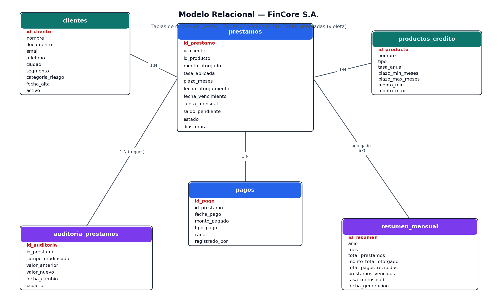
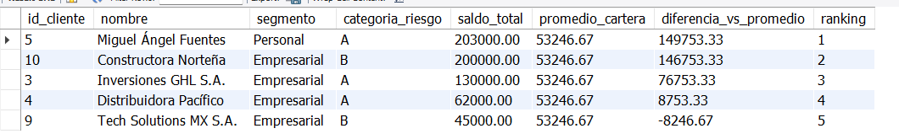
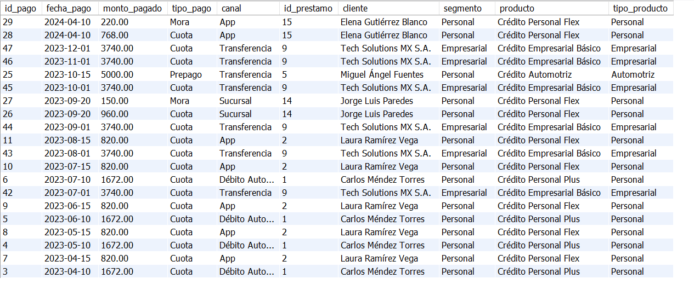
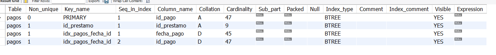

# 🏦 FinCore S.A. — Proyecto Avanzado SQL

Simulación de un sistema de gestión de créditos, construido en **MySQL 8.0+**, que modela el ciclo completo de préstamos: otorgamiento, seguimiento de pagos, auditoría, análisis de cartera y optimización de consultas.

Proyecto desarrollado como práctica de SQL avanzado, con funciones personalizadas, vistas, triggers, procedimientos almacenados con transacciones y optimización de consultas en un escenario financiero real.

Los datos son ficticios y fueron provistos por la cátedra para fines educativos.

---

## 🛠️ Tecnologías


---

## 🎯 Objetivo

Diseñar e implementar una solución completa de base de datos para FinCore S.A., una fintech de préstamos. El proyecto aplica funciones personalizadas, vistas, triggers, procedimientos almacenados con transacciones y optimización de consultas para monitorear la cartera crediticia, detectar clientes en mora, registrar pagos con seguridad transaccional y generar reportes mensuales automatizados.

---

## ❓ Preguntas de Negocio Respondidas

### 📊 Análisis de Cartera

- ¿Cuál es la distribución de la cartera por clasificación de mora (Al día, Mora Temprana, Mora Media, Mora Grave, Mora Crítica)?
- ¿Qué porcentaje de la cartera total se encuentra en cada tramo de riesgo?
- ¿Cuáles son los clientes con mayor exposición crediticia acumulada?

### 🔍 Seguimiento de Mora

- ¿En qué rango de antigüedad de mora se concentra el mayor volumen de saldo en riesgo?
- ¿Qué préstamos presentan más de 30, 60 y 90 días de mora?

### 💳 Comportamiento de Pagos

- ¿Cuál es el historial de pagos completo de la cartera?
- ¿Qué canales de pago son los más utilizados?
- ¿Cuántos pagos incluyen cargos por mora?

### 📋 Reporte Ejecutivo

- ¿Cuál es el resumen mensual de la operación crediticia (desembolsos, cobranza, morosidad)?
- ¿Cómo se distribuye la tasa promedio y el porcentaje de cartera en riesgo por segmento y categoría de riesgo?

---

## 🗂️ Estructura del Proyecto

```
fincore-sa-sql/
│
├── README.md
├── screenshots/
│   ├── diagrama_er.png                # Diagrama entidad-relación
│   ├── top_exposicion.png             # Resultado: Top 5 exposición crediticia
│   ├── historial_pagos.png            # Resultado: historial de pagos completo
│   └── show_index_pagos.png           # SHOW INDEX FROM pagos (verificación de índices)
├── scripts/
│   ├── 01_crear_tablas.sql            # DDL: estructura completa de la base de datos
│   ├── 02_insertar_datos.sql          # DML: datos de práctica provistos por la cátedra
│   └── 03_consultas_analisis.sql      # Exploración inicial + consultas de análisis de cartera
└── objetos/
    ├── funciones.sql                  # Función: fn_clasificar_mora
    ├── vistas.sql                     # Vistas: vw_estado_cartera y vw_resumen_clientes
    ├── triggers.sql                   # Trigger: trg_auditoria_estado
    ├── procedimientos.sql             # Procedimientos: sp_registrar_pago, sp_generar_resumen_mensual, sp_refinanciar_prestamo
    └── indices.sql                    # Índices de optimización + análisis EXPLAIN antes/después
```

> ⚠️ **Regla de la cátedra:** los datos originales de `datos_fincore.sql` (repartidos aquí entre `01_crear_tablas.sql` y `02_insertar_datos.sql`) **no fueron modificados**. Ver la sección [Inconsistencias detectadas en los datos](#-inconsistencias-detectadas-en-los-datos-de-práctica) más abajo.

---

## 🚧 Modelo de Datos

📌 Diagrama ER



### Tablas de Hechos

Registran transacciones y eventos operativos del negocio.

| Tabla                 | Descripción                                      | Columnas principales                                                                                                    |
| --------------------- | ------------------------------------------------ | ------------------------------------------------------------------------------------------------------------------------ |
| `prestamos`           | Registro de cada crédito otorgado                | `id_prestamo`, `id_cliente`, `id_producto`, `monto_otorgado`, `tasa_aplicada`, `saldo_pendiente`, `estado`, `dias_mora`  |
| `pagos`               | Pagos recibidos por cada préstamo                | `id_pago`, `id_prestamo`, `fecha_pago`, `monto_pagado`, `tipo_pago`, `canal`                                             |
| `auditoria_prestamos` | Log automático de cambios de estado en préstamos (poblada por `trg_auditoria_estado`) | `id_auditoria`, `id_prestamo`, `campo_modificado`, `valor_anterior`, `valor_nuevo`, `fecha_cambio`, `usuario` |
| `resumen_mensual`     | Consolidado mensual de operaciones (poblada por `sp_generar_resumen_mensual`) | `id_resumen`, `anio`, `mes`, `total_prestamos`, `monto_total_otorgado`, `total_pagos_recibidos`, `tasa_morosidad` |

### Tablas de Dimensión

Proveen contexto descriptivo a las tablas de hechos.

| Tabla               | Descripción                                     | Columnas principales                                                                                 |
| ------------------- | ------------------------------------------------ | ------------------------------------------------------------------------------------------------------ |
| `clientes`          | Registro de clientes personales y empresariales | `id_cliente`, `nombre`, `documento`, `segmento`, `categoria_riesgo`, `ciudad`, `activo`                |
| `productos_credito` | Catálogo de productos financieros disponibles   | `id_producto`, `nombre`, `tipo`, `tasa_anual`, `plazo_min_meses`, `plazo_max_meses`, `monto_min/max`   |

---

## ⚙️ Objetos de Base de Datos

### ƒ Función: `fn_clasificar_mora(dias_mora)`

Clasifica un préstamo según sus días de mora en cinco niveles de aging, siguiendo la política interna de FinCore S.A.

| Clasificación             | Criterio       |
| -------------------------- | -------------- |
| `Al día`                   | 0 días         |
| `Mora Temprana (1-30d)`    | 1 – 30 días    |
| `Mora Media (31-60d)`      | 31 – 60 días   |
| `Mora Grave (61-90d)`      | 61 – 90 días   |
| `Mora Crítica (+90d)`      | Más de 90 días |

```sql
-- Ejemplo de uso
SELECT fn_clasificar_mora(180);
-- Resultado: 'Mora Crítica (+90d)'

SELECT id_prestamo, dias_mora, fn_clasificar_mora(dias_mora) AS clasificacion
FROM prestamos
WHERE estado = 'Vencido';
```
> 📄 Código completo en `objetos/funciones.sql`

---

### 👁️ Vistas

#### `vw_estado_cartera`

Vista analítica del estado actual de la cartera a nivel de préstamo individual. Consolida datos de préstamos, clientes y productos, calcula el porcentaje de saldo restante sobre el monto original y aplica la clasificación de mora en tiempo real (vía `fn_clasificar_mora`).

```sql
-- Ejemplo de uso
SELECT clasificacion_mora, COUNT(*) AS cantidad, SUM(saldo_pendiente) AS exposicion
FROM vw_estado_cartera
GROUP BY clasificacion_mora;
```

#### `vw_resumen_clientes`

Resumen ejecutivo por cliente: total de préstamos, monto total otorgado, saldo pendiente consolidado, días de mora máximos y si el cliente tiene mora activa. Usa `LEFT JOIN` para incluir también a los clientes sin préstamos.

```sql
-- Ejemplo de uso
SELECT nombre, total_prestamos, saldo_pendiente_consolidado, tiene_mora_activa
FROM vw_resumen_clientes
ORDER BY saldo_pendiente_consolidado DESC;
```
> 📄 Código completo en `objetos/vistas.sql`

---

### ⚡ Trigger: `trg_auditoria_estado`

Se dispara automáticamente después de cada `UPDATE` sobre la tabla `prestamos` (una vez por fila afectada). Compara `OLD` vs `NEW` y registra en `auditoria_prestamos` cualquier cambio en los campos `estado` y `dias_mora`, guardando el valor anterior y el nuevo (un registro por campo modificado).

```sql
-- Se activa automáticamente al ejecutar:
UPDATE prestamos SET dias_mora = 75 WHERE id_prestamo = 16;
-- Queda registrado en auditoria_prestamos sin intervención manual
```
> 📄 Código completo en `objetos/triggers.sql`

---

### 📦 Procedimientos Almacenados

#### `sp_registrar_pago(p_id_prestamo, p_monto, p_tipo_pago, p_canal)`

Registra un pago sobre un préstamo `Activo` o `Vencido` dentro de una transacción atómica con manejo de errores (`SIGNAL`/`RESIGNAL`). Actualiza el saldo pendiente con `GREATEST(saldo - monto, 0)` para evitar saldos negativos, y cambia el estado a `Cancelado` si el saldo llega a cero. Rechaza pagos sobre préstamos `Cancelado` o `Refinanciado`.

```sql
-- Ejemplo de uso
CALL sp_registrar_pago(1, 1672.00, 'Cuota', 'App');
SELECT id_prestamo, saldo_pendiente, estado FROM prestamos WHERE id_prestamo = 1;
```

#### `sp_generar_resumen_mensual(p_anio, p_mes)`

Genera o actualiza el consolidado mensual de operaciones en `resumen_mensual`, usando `INSERT ... ON DUPLICATE KEY UPDATE` (patrón upsert) sobre la `UNIQUE KEY uk_anio_mes`. Calcula préstamos otorgados, monto desembolsado y pagos recibidos del período, y la tasa de morosidad sobre la foto actual de la cartera.

```sql
-- Ejemplo de uso
CALL sp_generar_resumen_mensual(2023, 6);
SELECT * FROM resumen_mensual WHERE anio = 2023 AND mes = 6;
```

#### `sp_refinanciar_prestamo(p_id_prestamo, p_nuevo_plazo_meses, p_nueva_tasa)`

Refinancia un préstamo `Activo` o `Vencido`: marca el original como `Refinanciado`, calcula la nueva cuota mensual con la **fórmula de amortización francesa** y crea un préstamo nuevo con el saldo pendiente como monto base. Ambas operaciones ocurren dentro de una única transacción, para que se realicen juntas o ninguna.

```sql
-- Fórmula aplicada: cuota = saldo * i * (1+i)^n / ((1+i)^n - 1)
CALL sp_refinanciar_prestamo(16, 24, 16.00);
```
> 📄 Código completo en `objetos/procedimientos.sql`

---

### 🔍 Índices

Índices creados sobre columnas de filtrado y ordenamiento frecuente, para optimizar las consultas analíticas de cartera.

| Índice                      | Tabla       | Columna(s)                      | Propósito                                                  |
| ---------------------------- | ----------- | -------------------------------- | ------------------------------------------------------------ |
| `idx_pagos_fecha_id`         | `pagos`     | `fecha_pago DESC, id_pago DESC` | Elimina el `filesort` en la consulta de historial de pagos  |
| `idx_prestamos_estado`       | `prestamos` | `estado`                        | Filtros por estado usados en Parte 5 (aging, reporte ejecutivo) y en `sp_generar_resumen_mensual` |

> ⚠️ **Nota analítica:** con el volumen de datos de práctica (47 filas en `pagos`), el optimizador de MySQL puede preferir espontáneamente un `Table scan` por costo estimado, ignorando el índice recién creado (`key: NULL` en `EXPLAIN`). Esto es un comportamiento esperado del optimizador, no un error de diseño: con `FORCE INDEX` se demuestra que el índice es correcto y que sería la elección automática del motor en un volumen de datos real (miles/millones de filas), donde el `filesort` sería mucho más costoso que la lectura ya ordenada por índice.
> 📄 Código completo en `objetos/indices.sql`

---

## 🚀 Cómo Ejecutarlo Localmente

### Requisitos

- MySQL 8.0 o superior
- MySQL Workbench (recomendado) o cualquier cliente SQL compatible

### Contenido de cada script

| Archivo                              | Qué contiene                                                                                     |
| ------------------------------------- | -------------------------------------------------------------------------------------------------- |
| `scripts/01_crear_tablas.sql`         | `DROP/CREATE DATABASE`, `CREATE TABLE` con PKs, FKs y ENUMs (dato original de cátedra, sin modificar) |
| `scripts/02_insertar_datos.sql`       | `INSERT INTO` con 20 clientes, 6 productos, 22 préstamos y pagos de práctica (dato original de cátedra, sin modificar) |
| `scripts/03_consultas_analisis.sql`   | Exploración inicial (Parte 1) + aging, exposición crediticia, historial de pagos y reporte ejecutivo (Parte 5) |
| `objetos/funciones.sql`               | `fn_clasificar_mora` — clasificación de mora en 5 niveles con `IF/ELSEIF`                        |
| `objetos/vistas.sql`                  | `vw_estado_cartera` y `vw_resumen_clientes`, esta última con `LEFT JOIN` + `COALESCE`             |
| `objetos/triggers.sql`                | `trg_auditoria_estado` — auditoría automática de cambios de estado/mora, con prueba manual incluida |
| `objetos/procedimientos.sql`          | `sp_registrar_pago`, `sp_generar_resumen_mensual`, `sp_refinanciar_prestamo` con transacciones y manejo de errores |
| `objetos/indices.sql`                 | Índices simples y compuesto, con `EXPLAIN` antes/después                                          |

### Pasos de ejecución

```sql
-- 1. Crear la estructura e insertar los datos de práctica
SOURCE scripts/01_crear_tablas.sql;
SOURCE scripts/02_insertar_datos.sql;

-- 2. Crear los objetos en este orden (respetar dependencias)
SOURCE objetos/funciones.sql;
SOURCE objetos/vistas.sql;
SOURCE objetos/triggers.sql;
SOURCE objetos/procedimientos.sql;
SOURCE objetos/indices.sql;

-- 3. Ejecutar el análisis de cartera
SOURCE scripts/03_consultas_analisis.sql;
```

> ⚠️ Los objetos deben crearse después de los datos: las vistas, el trigger y los procedimientos dependen de que las tablas existan y tengan contenido para poder probarse. Antes de entregar, el proyecto se corrió completo desde cero (`DROP DATABASE IF EXISTS fincore_sa` incluido en el paso 1) sobre una instancia limpia, sin errores.

---

## ⚠️ Inconsistencias Detectadas en los Datos de Práctica

Como parte de la exploración inicial (Parte 1), se auditaron los datos de `datos_fincore.sql` y se detectaron 2 inconsistencias reales, **no corregidas** en los scripts (regla de la cátedra: no modificar los datos originales):

1. **FK mal referenciada en `pagos`:** el bloque de pagos comentado como "préstamo 17 (Cancelado — Laura)" usa `id_prestamo = 17`, pero ese préstamo pertenece a Carlos Méndez (cuota 955.00). Los montos y fechas de esos pagos (1015.00, 12 cuotas de jul-2021 a jun-2022) coinciden con la cuota del préstamo `id_prestamo = 18`, que sí es de Laura Ramírez.
2. **Préstamos otorgados antes del alta del cliente:** los préstamos `id_prestamo = 16` (cliente *Servicios Omega Ltda.*) y `id_prestamo = 21` (cliente *Andrés Ramírez Soto*) tienen `fecha_otorgamiento` anterior a la `fecha_alta` del cliente correspondiente.

Estas inconsistencias se dejan documentadas como parte del análisis de calidad de datos, sin alterar el script original.

---

## 📷 Capturas de Resultados Clave

### Top Clientes por Exposición Crediticia



### Historial de Pagos Completo



### Verificación de Índices (`SHOW INDEX FROM pagos`)



---

## 💡 Conceptos y Técnicas Aplicadas

| Categoría            | Técnica                                                                                |
| --------------------- | ---------------------------------------------------------------------------------------- |
| Funciones             | `DELIMITER`, `RETURNS`, `DETERMINISTIC`, `IF/ELSEIF`                                    |
| Vistas                | `CREATE VIEW`, `LEFT JOIN` + `COALESCE` para cobertura completa de clientes             |
| Triggers              | `AFTER UPDATE ... FOR EACH ROW`, `OLD`/`NEW`, operador null-safe `<=>`                   |
| Procedimientos        | Parámetros `IN`, `DECLARE`, `EXIT HANDLER FOR SQLEXCEPTION`, `START TRANSACTION`/`COMMIT`/`ROLLBACK` |
| Manejo de errores     | `SIGNAL SQLSTATE '45000'` para errores de negocio, `RESIGNAL` para propagarlos           |
| Upsert                | `INSERT ... ON DUPLICATE KEY UPDATE` sobre `UNIQUE KEY uk_anio_mes`                      |
| Concurrencia          | `SELECT ... FOR UPDATE` para bloquear la fila del préstamo durante el pago               |
| Fórmula financiera    | Amortización francesa: `cuota = saldo * i * (1+i)^n / ((1+i)^n - 1)`                     |
| Funciones de ventana  | `SUM(...) OVER ()`, `AVG(...) OVER ()`, `RANK() OVER (ORDER BY ...)`                     |
| Agregación condicional| `SUM(CASE WHEN ... THEN ... ELSE 0 END)`, `NULLIF(..., 0)` para evitar división por cero |
| Optimización          | `CREATE INDEX`, `EXPLAIN` (formato tree), `FORCE INDEX`, interpretación de `Table scan`, `Index scan`, `filesort` |

---

## 📝 Conclusiones

- Encapsular la regla de clasificación de mora en `fn_clasificar_mora` garantiza consistencia: cualquier vista, procedimiento o consulta que la use siempre aplica el mismo criterio, sin riesgo de divergencias.
- Los procedimientos con transacciones (`sp_registrar_pago`, `sp_refinanciar_prestamo`) muestran que SQL puede ejecutar lógica de negocio compleja de forma atómica — si una parte de la operación falla, ninguna queda a mitad de camino.
- El análisis `EXPLAIN` antes/después de crear índices dejó un aprendizaje clave: que el optimizador de MySQL ignore un índice válido en una tabla pequeña no es un error, es una decisión de costos — el mismo índice sería elegido automáticamente con un volumen de datos real.
- Explorar los datos antes de construir cualquier objeto permitió detectar inconsistencias reales (una FK que apunta al préstamo equivocado, préstamos anteriores al alta del cliente) sin necesidad de modificar el script original de la cátedra.

---

*Proyecto desarrollado como práctica de SQL avanzado con MySQL.*
